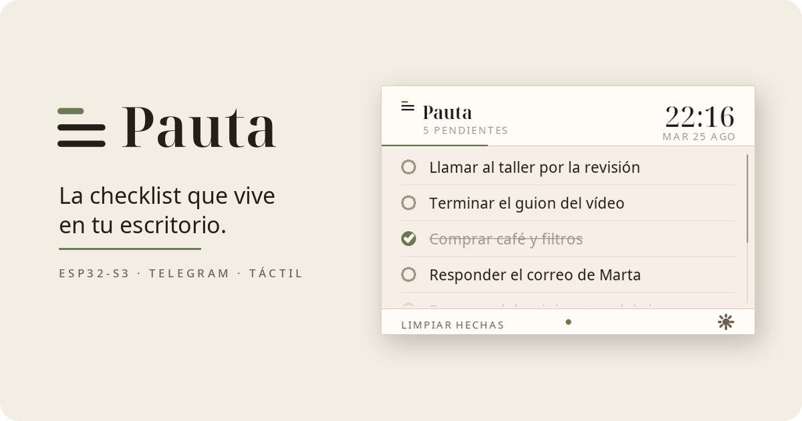
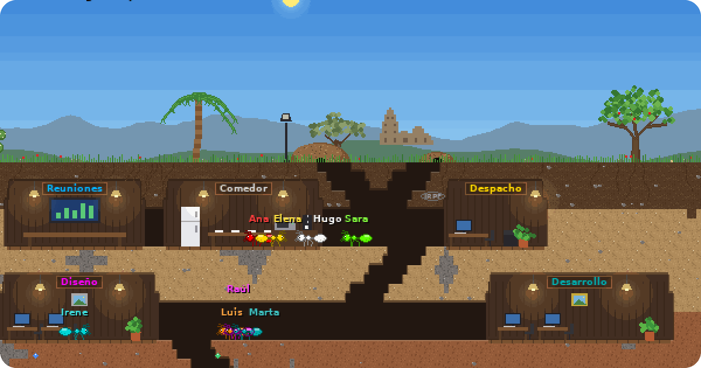

<picture>
  <source media="(prefers-color-scheme: dark)" srcset="assets/banner-dark.svg">
  
</picture>

### `$ cat sobre_mi.h`

```c
struct ingeniero ignacio = {
    .oficio    = "ciberseguridad + inteligencia artificial",
    .base      = "Málaga",
    .intereses = { "proyectos maker", "ingeniería inversa", "ciberseguridad", "hardware", "rf" },
    .metodo    = "abrirlo, entenderlo y construir el mío",
};
```

*Cybersecurity & AI engineer from Málaga. I take things apart to see how they work, then build my own.*

### `$ ls ~/proyectos`

<table>
  <tr>
    <td width="50%" valign="top">
      <a href="https://github.com/Ignacio-Aranda/pauta"></a>
      <h3><a href="https://github.com/Ignacio-Aranda/pauta">Pauta</a></h3>
      <p>La checklist que vive en tu escritorio. Le escribes por Telegram, aparece en una pantalla táctil y la tachas con el dedo.</p>
      <p><code>ESP32-S3</code> <code>C++</code> <code>Telegram</code></p>
    </td>
    <td width="50%" valign="top">
      <a href="https://github.com/Ignacio-Aranda/Ant-Farm-Idle"></a>
      <h3><a href="https://github.com/Ignacio-Aranda/Ant-Farm-Idle">Ant Farm Idle</a></h3>
      <p>Un hormiguero en pixel art para una pantalla siempre encendida. Cada persona de tu grupo es una hormiga, y vive el tiempo real de tu ciudad.</p>
      <p><code>Python</code> <code>pygame</code> <code>Raspberry Pi</code></p>
    </td>
  </tr>
</table>

<p align="right"><a href="https://github.com/Ignacio-Aranda?tab=repositories">Ver todos los repositorios →</a></p>

### `$ cat herramientas.txt`

<picture>
  <source media="(prefers-color-scheme: dark)" srcset="assets/stack-dark.svg">
  
</picture>

<!-- Para añadir o quitar herramientas (Ghidra, radare2, PyTorch...), edita ITEMS en tools/stack.py y vuelve a generar. -->

<br>

<p align="center">
  <a href="https://www.linkedin.com/in/ignacioaranda">LinkedIn</a>
  &nbsp;·&nbsp;
  <a href="https://github.com/Ignacio-Aranda?tab=repositories">Repositorios</a>
</p>


